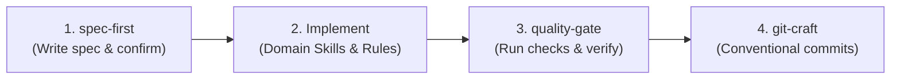

# Project Agent Guidelines & Skills Orchestration

This project is configured with a modular suite of workspace skills and development rules located in [`.agents/`](file:///c:/Users/tinna/Documents/antigravity/goofy-pascal/.agents). All agents operating within this workspace must adhere to the following workflow and skill lifecycle.

---

## 1. Skill Lifecycle & Workflow Pipeline

For every development task in this workspace, follow this 4-step pipeline:

1. **Planning (`spec-first`):**
   - Before starting any non-trivial coding, data pipeline, plan, or documentation task, write a brief specification in [`specs/`](file:///c:/Users/tinna/Documents/antigravity/goofy-pascal/specs) following [`spec_template.md`](file:///c:/Users/tinna/Documents/antigravity/goofy-pascal/.agents/skills/spec-first/resources/spec_template.md).
   - Get user confirmation before writing code.
2. **Implementation (Domain Skills & Rules):**
   - Follow the domain-specific skills according to the task type:
     - **Python Scripts & Utilities:** Apply [`python-craft`](file:///c:/Users/tinna/Documents/antigravity/goofy-pascal/.agents/skills/python-craft/SKILL.md) and [`ai-python-cpp`](file:///c:/Users/tinna/Documents/antigravity/goofy-pascal/.agents/skills/ai-python-cpp/SKILL.md).
     - **Full-Stack Web (Next.js / TS):** Apply [`web-code`](file:///c:/Users/tinna/Documents/antigravity/goofy-pascal/.agents/skills/web-code/SKILL.md).
     - **Data Pipelines & Analysis:** Apply [`data-craft`](file:///c:/Users/tinna/Documents/antigravity/goofy-pascal/.agents/skills/data-craft/SKILL.md).
     - **Performance & Acceleration:** Apply [`perf-optimizer`](file:///c:/Users/tinna/Documents/antigravity/goofy-pascal/.agents/skills/perf-optimizer/SKILL.md) and [`SpeedOptimizer`](file:///c:/Users/tinna/Documents/antigravity/goofy-pascal/.agents/skills/SpeedOptimizer/SKILL.md).
     - **Security & DLP:** Strictly follow [`LocalAISecurity`](file:///c:/Users/tinna/Documents/antigravity/goofy-pascal/.agents/skills/LocalAISecurity/SKILL.md).
     - **Token Efficiency:** When active or requested, use [`caveman-token`](file:///c:/Users/tinna/Documents/antigravity/goofy-pascal/.agents/skills/caveman-token/SKILL.md).
3. **Verification (`quality-gate`):**
   - Never declare a task complete without passing the [`quality-gate`](file:///c:/Users/tinna/Documents/antigravity/goofy-pascal/.agents/skills/quality-gate/SKILL.md).
   - Verify syntax, linting, tests, and acceptance criteria with executable evidence.
4. **Release & Documentation (`git-craft` & `doc-craft`):**
   - Stage and commit changes using Conventional Commits via [`git-craft`](file:///c:/Users/tinna/Documents/antigravity/goofy-pascal/.agents/skills/git-craft/SKILL.md).
   - Keep README and runbooks verified against reality via [`doc-craft`](file:///c:/Users/tinna/Documents/antigravity/goofy-pascal/.agents/skills/doc-craft/SKILL.md).

---

## 2. Workspace Skills Registry

| Skill Name | Path | Primary Purpose |
| :--- | :--- | :--- |
| **`spec-first`** | [`.agents/skills/spec-first/SKILL.md`](file:///c:/Users/tinna/Documents/antigravity/goofy-pascal/.agents/skills/spec-first/SKILL.md) | Enforce upfront specs and criteria agreement before coding. |
| **`quality-gate`** | [`.agents/skills/quality-gate/SKILL.md`](file:///c:/Users/tinna/Documents/antigravity/goofy-pascal/.agents/skills/quality-gate/SKILL.md) | Automated pre-completion checks, evidence gathering, and self-review. |
| **`python-craft`** | [`.agents/skills/python-craft/SKILL.md`](file:///c:/Users/tinna/Documents/antigravity/goofy-pascal/.agents/skills/python-craft/SKILL.md) | Production-ready Python architecture (`pathlib`, CLI args, structured logging). |
| **`ai-python-cpp`** | [`.agents/skills/ai-python-cpp/SKILL.md`](file:///c:/Users/tinna/Documents/antigravity/goofy-pascal/.agents/skills/ai-python-cpp/SKILL.md) | AI/ML, PyTorch/NumPy idioms, PEP 8 (`ruff`), C++20 RAII, test integrity. |
| **`web-code`** | [`.agents/skills/web-code/SKILL.md`](file:///c:/Users/tinna/Documents/antigravity/goofy-pascal/.agents/skills/web-code/SKILL.md) | Next.js 14 App Router, TypeScript, Tailwind CSS, Prisma, Vitest, Playwright. |
| **`data-craft`** | [`.agents/skills/data-craft/SKILL.md`](file:///c:/Users/tinna/Documents/antigravity/goofy-pascal/.agents/skills/data-craft/SKILL.md) | Zero-dump EDA, non-destructive data cleaning, transformation pipelines. |
| **`perf-optimizer`** | [`.agents/skills/perf-optimizer/SKILL.md`](file:///c:/Users/tinna/Documents/antigravity/goofy-pascal/.agents/skills/perf-optimizer/SKILL.md) | Profile-first optimization, downcasting, chunking, eliminating Pandas loops. |
| **`SpeedOptimizer`** | [`.agents/skills/SpeedOptimizer/SKILL.md`](file:///c:/Users/tinna/Documents/antigravity/goofy-pascal/.agents/skills/SpeedOptimizer/SKILL.md) | 4-Phase acceleration engine for backends, web, local AI inference, and databases. |
| **`LocalAISecurity`** | [`.agents/skills/LocalAISecurity/SKILL.md`](file:///c:/Users/tinna/Documents/antigravity/goofy-pascal/.agents/skills/LocalAISecurity/SKILL.md) | Strict DLP, secret sanitization, air-gap guardrails, safe model loading. |
| **`git-craft`** | [`.agents/skills/git-craft/SKILL.md`](file:///c:/Users/tinna/Documents/antigravity/goofy-pascal/.agents/skills/git-craft/SKILL.md) | Semantic conventional commits, secret screening, and changelog maintenance. |
| **`doc-craft`** | [`.agents/skills/doc-craft/SKILL.md`](file:///c:/Users/tinna/Documents/antigravity/goofy-pascal/.agents/skills/doc-craft/SKILL.md) | Reality-synced documentation, runbooks, and Architecture Decision Records (ADRs). |
| **`caveman-token`** | [`.agents/skills/caveman-token/SKILL.md`](file:///c:/Users/tinna/Documents/antigravity/goofy-pascal/.agents/skills/caveman-token/SKILL.md) | Full-duplex token optimization (Think-in-Code sandboxing + terse output). |

---

## 3. Workspace Rules

In addition to skills, persistent directory rules are configured in [`.agents/rules/`](file:///c:/Users/tinna/Documents/antigravity/goofy-pascal/.agents/rules):
- [`ai-python-cpp.md`](file:///c:/Users/tinna/Documents/antigravity/goofy-pascal/.agents/rules/ai-python-cpp.md): AI & Systems coding standards.
- [`web-code.md`](file:///c:/Users/tinna/Documents/antigravity/goofy-pascal/.agents/rules/web-code.md): Web stack architectural guidelines.
