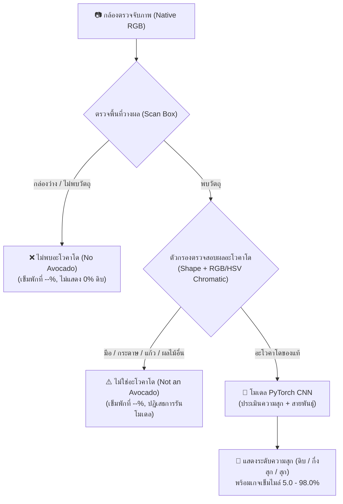

# 🥑 Avocado Ripeness & Variety Detection System
### ระบบตรวจวัดระดับความสุกและจำแนกสายพันธุ์อะโวคาโด (Native RGB, Multi-State AI & 85.42 mm × 55.60 mm Touchscreen Kiosk)

[](https://www.raspberrypi.com/products/raspberry-pi-5/)
[-blue.svg)](#-การแสดงผลบนจอฮาร์ดแวร์-8542-mm--5560-mm-hardware-touchscreen-guide)
[](#-สถาปัตยกรรมระบบ-rgb-และการคัดกรองวัตถุ-rgb-pipeline--validation)
[-red.svg)](https://pytorch.org/)
[](#-ความปลอดภัยและประสิทธิภาพ-security--speed-optimizations)
[](LICENSE)

ระบบ AI ตรวจวัดระดับความสุกและจำแนกสายพันธุ์ผลอะโวคาโดแบบ **On-Demand (Standby Live Preview + ตรวจวัดเมื่อสั่งการ)** ออกแบบมาสำหรับการใช้งานทั้งบนเครื่องคอมพิวเตอร์ทั่วไป และบนตู้คัดแยกอัตโนมัติ/หน้าจอสัมผัสขนาดกะทัดรัด **Raspberry Pi 5** 

รองรับกล้องคู่ **Dual MIPI CSI (OV5647 / IMX)** บนบอร์ด Raspberry Pi 5 และ **Dual USB Webcams** บน Windows/Linux

---

## 🌟 ฟีเจอร์เด่นที่พัฒนาขึ้นใหม่ (New & Upgraded Features)



1. **Native RGB Color Pipeline (มาตรฐานสี RGB888 ตรงกันทั้งระบบ):**
   - กล้องทุกชนิด (Picamera2, USB Video, Simulation) ดึงและส่งข้อมูลภาพในรูปแบบ **RGB888** โดยตรง
   - ขจัดปัญหา Channel BGR/RGB สลับกัน ทำให้การวิเคราะห์เม็ดสีเขียว (Unripe) และสีน้ำตาลเข้ม/ดำ (Ripe) แม่นยำสูงสุด
2. **ระบบตรวจจับกล่องว่าง (Empty Box Detection — ไม่ขึ้น 0% ดิบปลอม):**
   - เมื่อไม่มีผลไม้อยู่ในกล่องสแกน ระบบจะแจ้งว่า **"❌ ไม่พบอะโวคาโด (No Avocado Detected)"**
   - เข็มเกจวัดความสุกจะพักอยู่ที่สถานะ **`--%`** (สีเทา Neutral) โดยไม่ขึ้นตัวเลขหลอกว่า "0% ดิบ"
3. **ระบบคัดกรองวัตถุแปลกปลอม (Non-Avocado Object Rejection Filter):**
   - ตรวจสอบรูปทรงความโค้งมนนูน (Convexity & Solidity $\ge 0.78$)
   - กรองสีผิวหนังและมือมนุษย์ (Human Hand / Skin Tone Filter ในระบบสี YCrCb)
   - กรองวัตถุสีขาวจัด เช่น ถ้วยกระดาษ กล่อง หรือกระดาษ A4
   - กรองวัตถุสีสดที่ไม่ใช่อะโวคาโด (สีแดงสด เช่น แอปเปิ้ล, สีฟ้า, สีเหลืองสด)
   - หากตรวจพบวัตถุที่ไม่ใช่อะโวคาโด ระบบจะแจ้งเตือนทันทีว่า **"⚠️ ไม่ใช่อะโวคาโด (Not an Avocado)"** และไม่แสดงค่าความสุก
4. **โหมดหน้าจอฮาร์ดแวร์ขนาดกะทัดรัด (85.42 mm × 55.60 mm Landscape Layout):**
   - ออกแบบ UI แนวนอนขนาด **480 × 320 พิกเซล** รองรับหน้าจอสัมผัส LCD ขนาด 3.5" - 4.0" (ขนาดพื้นที่แสดงผล 85.42 mm กว้าง × 55.60 mm สูง)
   - ปุ่มสัมผัสขนาดใหญ่พิเศษสูง 46–48 px สัมผัสด้วยนิ้วมือได้ง่าย ไม่ต้องใช้สไตลัส
   - ปุ่มสลับมุมมองกล้อง `[ 📷 CAM 1 | 📷 CAM 2 ]` สำหรับตรวจสอบผลได้ทั้งสองด้านในหน้าจอเดียว

---

## 📱 การแสดงผลบนจอฮาร์ดแวร์ (85.42 mm × 55.60 mm Hardware Touchscreen Guide)

หน้าจอขนาด **85.42 mm (กว้าง) × 55.60 mm (สูง)** เป็นขนาดหน้าจอมาตรฐานแนวนอน (Landscape อัตราส่วน ~3:2) ที่นิยมใช้กับ Raspberry Pi เช่น หน้าจอ LCD HAT 3.5 นิ้ว (ความละเอียด 480 × 320):

```
+--------------------------------------------------------------+
| 🥑 Avocado Inspector          [ 📷 CAM 1 ]  [ ⛶ ]  ● STANDBY |
+-------------------------------+------------------------------+
|                               |  🥑 ความสุก: สุก (Ripe)      |
|                               |  🏷️ สายพันธุ์: Hass (91%)    |
|       [ ภาพสดจากกล้อง ]       |                              |
|       (แตะเพื่อตรวจวัด)       |       [ เกจวัดเข็มไมล์ ]     |
|                               |            88.5%             |
+-------------------------------+------------------------------+
|              📸 แตะเพื่อตรวจวัด (Tap to Scan)                 |
+--------------------------------------------------------------+
```

### การตั้งค่าเปิดโหมดกะทัดรัด 480 × 320:
ในไฟล์ `configs/default.yaml`:
```yaml
display:
  mode: "compact_landscape"    # "compact_landscape" สำหรับจอ 85.42mm x 55.60mm, หรือ "desktop" สำหรับจอคอมพิวเตอร์ทั่วไป
  width: 480
  height: 320
  fullscreen: false            # ตั้งเป็น true หากต้องการให้เปิดเต็มจอ Kiosk ทันที
```
*(หากตั้งเป็น `mode: "auto"` ระบบจะตรวจจับความละเอียดหน้าจออัตโนมัติ หากความละเอียดต่ำกว่าหรือเท่ากับ 640×480 จะสลับเข้าโหมด Compact แนวนอนทันที)*

---

## 🎮 ปุ่มควบคุมและคีย์ลัด (Controls & Shortcuts)

| ปุ่มบนหน้าจอ | ปุ่มลัดคีย์บอร์ด | หน้าที่การทำงาน |
| :--- | :--- | :--- |
| **📸 แตะเพื่อตรวจวัด** | `Spacebar` / `Enter` | Freeze ภาพกล้อง วิเคราะห์ระดับความสุกและสายพันธุ์ทันที |
| **🔄 ตรวจผลถัดไป** | `Spacebar` / `Enter` | รีเซ็ตผลการตรวจวัด กลับสู่โหมด Standby รอตรวจผลต่อไป |
| **📷 CAM 1 / CAM 2** | `Tab` | สลับมุมมองภาพระหว่างกล้องตัวที่ 1 และตัวที่ 2 |
| **⛶ สลับโหมดเต็มจอ** | `F11` / `Escape` | ขยายเต็มจอสำหรับจอสัมผัส Touchscreen Kiosk |
| **แตะที่ภาพกล้อง** | คลิกเมาส์ซ้าย / ทัชสกรีน | สั่งตรวจวัดภาพได้ทันทีโดยไม่ต้องเล็งปุ่มด้านล่าง |

---

## 💻 คู่มือการติดตั้งบน Windows (Windows Installation Guide)

### วิธีที่ 1: รันจาก Source Code / Scripts
1. Clone โปรเจกต์ไปยังเครื่อง:
   ```powershell
   git clone -b AfterComment https://github.com/Kuma2438/Ripeness-Level-Detection-of-Avocado-Fruit-Using-Image-Processing-Technology.git
   cd Ripeness-Level-Detection-of-Avocado-Fruit-Using-Image-Processing-Technology
   ```
2. ดับเบิ้ลคลิกไฟล์ **`run.bat`** (สคริปต์จะตรวจหา Python, สร้าง Virtual Environment และดาวน์โหลด Dependencies ให้อัตโนมัติ)
3. เลือกเมนู **`[1]`** เพื่อเปิดใช้งานโปรแกรม

---

## 🍓 คู่มือการติดตั้งบน Linux & Raspberry Pi 5 (Linux & Pi 5 Guide)

```bash
# 1. Clone Source Code
git clone -b AfterComment https://github.com/Kuma2438/Ripeness-Level-Detection-of-Avocado-Fruit-Using-Image-Processing-Technology.git
cd Ripeness-Level-Detection-of-Avocado-Fruit-Using-Image-Processing-Technology

# 2. ให้สิทธิ์การรันสคริปต์
chmod +x scripts/install_linux.sh run.sh

# 3. รันสคริปต์ติดตั้งระบบอัตโนมัติ
sudo bash scripts/install_linux.sh
```

### การเปิดโปรแกรม:
- ดับเบิ้ลคลิกไอคอน **Avocado Ripeness Inspector** บน Desktop
- หรือพิมพ์ใน Terminal:
  ```bash
  avocado-inspector
  # หรือ
  ./run.sh 1
  ```

---

## 🤖 โหมดเชื่อมต่อแขนกลคัดแยกและ PLC (Robotics & JSON API)

สำหรับสายพานคัดแยกผลไม้อัตโนมัติ สามารถรันโปรแกรมในโหมด CLI Stream ข้อมูล JSON ผ่านทาง Serial / Standard Output ได้:

```bash
python scripts/run_cli.py --interactive --json
```

**ตัวอย่างผลลัพธ์ JSON เมื่อตรวจวัด:**
```json
{
  "status": "DETECTED",
  "ripeness": "Ripe",
  "score": 88.5,
  "confidence": 92.4,
  "variety": "Hass",
  "variety_confidence": 91.0,
  "latency_ms": 11.2
}
```

**เมื่อกล่องว่าง (ไม่มีผลไม้):**
```json
{
  "status": "NO_AVOCADO",
  "ripeness": "No Avocado",
  "score": null,
  "confidence": 0.0,
  "rejection_reason": "Box is empty / no object found"
}
```

**เมื่อวางสิ่งของอื่นที่ไม่ใช่อะโวคาโด (เช่น มือ หรือ ถ้วย):**
```json
{
  "status": "NOT_AVOCADO",
  "ripeness": "Not Avocado",
  "score": null,
  "confidence": 0.0,
  "rejection_reason": "Human hand/skin detected (ตรวจพบมือหรือผิวหนัง)"
}
```

---

## 🧪 การทดสอบระบบ (Automated Tests)

```bash
python -m unittest discover -s tests -p "test_*.py"
```

---

## 🛡️ ความปลอดภัยและประสิทธิภาพ (Security & Speed Optimizations)

- 🔒 **Safe Model Deserialization**: บังคับใช้ `weights_only=True` ใน `torch.load()` ป้องกันช่องโหว่ Arbitrary Code Execution
- 🔒 **Air-Gap & DLP Guardrails**: กฎ `.gitignore` ป้องกันข้อมูลลับ รหัสผ่าน และไฟล์น้ำหนักโมเดลขนาดใหญ่
- ⚡ **Zero-Allocation RGB Processing**: วิเคราะห์ภาพด้วยสถาปัตยกรรม Native RGB888 ลดขั้นตอนการแปลงซ้ำซ้อน
- ⚡ **Double-Buffered Asynchronous Capture**: แยก Thread ดึงภาพจากกล้องอิสระ ทำให้การแสดงผลสด 60 FPS ลื่นไหล
- ⚡ **Otsu + Morphological Filtering**: อัลกอริทึมตัดขอบรูปทรงนูน (Convexity) ตรวจจับและแยกแยะวัตถุได้อย่างแม่นยำ

---

## 📄 License
โปรเจกต์นี้เผยแพร่ภายใต้สัญญาอนุญาต **MIT License**
